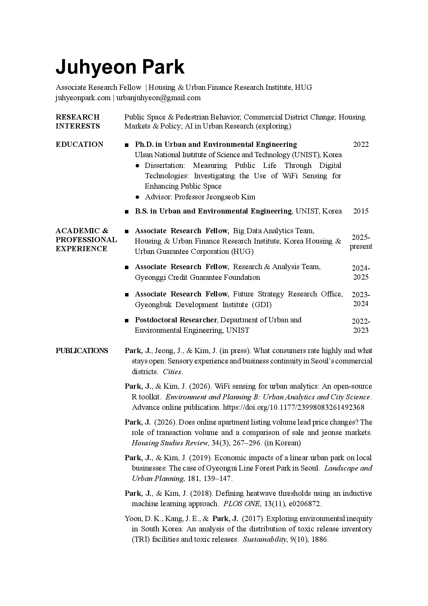
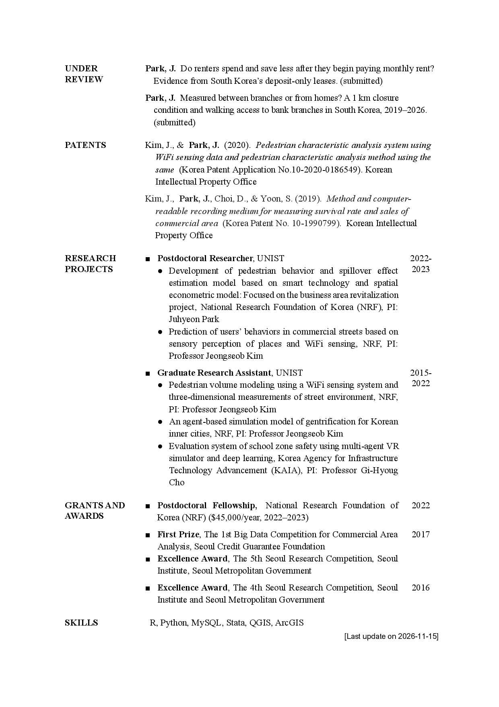

::: cv-bar
[Updated November 2026 · 2 pages]{.cv-updated}

[Download PDF](cv_jhyeon_v15.pdf){.btn .btn-outline-secondary .btn-sm download="Juhyeon_Park_CV.pdf"}
:::

::: cv-pages
[{fig-alt="CV of Juhyeon Park, page 1"}](cv_jhyeon_v15.pdf)
[{fig-alt="CV of Juhyeon Park, page 2"}](cv_jhyeon_v15.pdf)
:::
